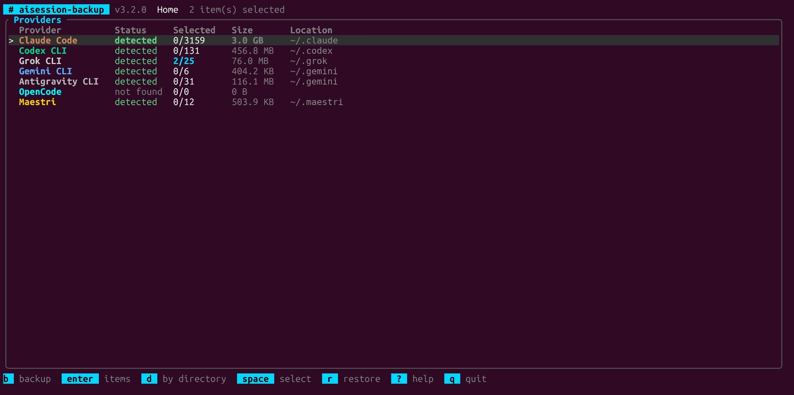

# aisession-backup

Backup, restore e migração de sessões e configuração de ferramentas de IA para
terminal entre máquinas, com plano prévio, rollback e remapeamento preciso de
paths.

AI session backup and migration for terminal coding tools: Claude Code, Codex,
Grok, Gemini, Antigravity, Maestri and OpenCode.

[](LICENSE)
[](Cargo.toml)
[](https://github.com/vynazevedo/aisession-backup/actions/workflows/ci.yml)
[](https://www.rust-lang.org)
[](#instalação)



---

## Provedores suportados

| Provedor | Id | O que entra no backup | Paths remapeados no restore |
|----------|----|-----------------------|-----------------------------|
| Claude Code | `claude` | Sessões, subagentes, memória, extras e config | `cwd` de cada linha do JSONL e diretório encoded |
| Codex CLI | `codex` | Rollouts e `config.toml` | `cwd` e workspaces dos rollouts, projetos do `config.toml` |
| Grok CLI | `grok` | Sessões por diretório | Diretório da sessão, `info.cwd` e `git_root_dir` |
| Gemini CLI | `gemini` | Chats, `projects.json` e `trustedFolders.json` | `.project_root`, `projects.json` e `trustedFolders.json` |
| Antigravity CLI | `agy` | Conversas, `brain/`, histórico e settings | `history.jsonl` e `trustedWorkspaces` |
| Maestri | `maestri` | Workspaces, notas, preferências e layout | `workingDirectory` dos workspaces e terminais |
| OpenCode | `opencode` | `storage/` | Nenhum: cópia literal, formato não validado |

Limitações conhecidas:

- Conversas do Antigravity (`conversations/*.db`) e bancos SQLite do Codex são
  copiados sem reescrita interna. Eles continuam citando os paths antigos, e o
  índice de threads do Codex não é atualizado.
- Diretórios do Gemini identificados por hash continuam sob o hash antigo.
- Um banco SQLite em uso pode ser copiado em estado intermediário. Para esses
  arquivos, feche a ferramenta antes do backup.

---

## Instalação

### Binário pré-compilado

Baixe o arquivo da sua plataforma em
[Releases](https://github.com/vynazevedo/aisession-backup/releases/latest).

| Plataforma | Arquivo |
|------------|---------|
| Linux x86_64 | `aisession-backup-x86_64-unknown-linux-gnu.tar.gz` |
| Linux ARM64 | `aisession-backup-aarch64-unknown-linux-gnu.tar.gz` |
| macOS Apple Silicon | `aisession-backup-aarch64-apple-darwin.tar.gz` |
| macOS Intel | `aisession-backup-x86_64-apple-darwin.tar.gz` |
| Windows x86_64 | `aisession-backup-x86_64-pc-windows-msvc.zip` |

```bash
curl -L -o aisession-backup.tar.gz \
  https://github.com/vynazevedo/aisession-backup/releases/latest/download/aisession-backup-x86_64-unknown-linux-gnu.tar.gz
tar -xzf aisession-backup.tar.gz
chmod +x aisession-backup
sudo mv aisession-backup /usr/local/bin/
```

No macOS, se o Gatekeeper bloquear o binário não assinado:

```bash
xattr -d com.apple.quarantine aisession-backup
```

No Windows, em PowerShell:

```powershell
Invoke-WebRequest -OutFile aisession-backup.zip `
  https://github.com/vynazevedo/aisession-backup/releases/latest/download/aisession-backup-x86_64-pc-windows-msvc.zip
Expand-Archive aisession-backup.zip -DestinationPath .
.\aisession-backup.exe version
```

Coloque o `aisession-backup.exe` em uma pasta do `PATH` para usar os comandos abaixo
sem o `.\`.

### Compilar do código

Requer Rust 1.85 ou superior.

```bash
cargo install --git https://github.com/vynazevedo/aisession-backup
```

---

## Início rápido

```bash
# Na origem: veja o que foi detectado e procure segredos
aisession-backup doctor
aisession-backup audit --provider all

# Confira o plano e gere um backup criptografado
aisession-backup backup --provider all --encrypt -o tudo.tar.gz.age --dry-run
aisession-backup backup --provider all --encrypt -o tudo.tar.gz.age

# No destino: confira o plano e restaure
aisession-backup verify tudo.tar.gz.age
aisession-backup restore tudo.tar.gz.age -m "/home/u:/Users/u" --dry-run
aisession-backup restore tudo.tar.gz.age -m "/home/u:/Users/u"

# Se precisar desfazer
aisession-backup history
aisession-backup rollback <ID>
```

Sem argumentos em um terminal, `aisession-backup` abre a interface interativa.
Sem terminal, mostra a ajuda.

---

## Convertendo sessões entre Claude Code e Codex

`convert` leva uma conversa de uma ferramenta para a outra. Por exemplo, para
continuar no Claude Code uma sessão iniciada no Codex:

```bash
aisession-backup convert <id-da-sessão> --to claude --dry-run
aisession-backup convert <id-da-sessão> --to claude
cd /caminho/do/projeto && claude --resume <id-gerado>
```

A sessão de origem pode ser indicada pelo id, como aparece em `list` e `scan`, ou
pelo caminho do arquivo. A ferramenta de origem é detectada pelo formato, e
`--from` resolve ambiguidades. `-m origem:destino` muda o diretório do projeto, e
`--dest` grava em outro diretório da ferramenta de destino. Na interface, a tecla
`t` converte a sessão sob o cursor.

| Item | O que acontece |
|------|----------------|
| Mensagens do usuário e do assistente | Convertidas, na ordem original |
| Chamadas de ferramenta e resultados | Viram texto legível, com até 2.000 caracteres cada |
| Raciocínio do modelo | Fica de fora. O do Codex é criptografado e o do Claude é assinado |
| Imagens | Ficam de fora |
| Contexto injetado pela ferramenta | Fica de fora, como `AGENTS.md` e lembretes de sistema |
| Subagentes do Claude Code | Ficam de fora |

A primeira mensagem da sessão convertida informa a origem. O plano lista tudo o
que ficou de fora, e o relatório em `--json` traz as contagens.

- **Idempotente.** O id da sessão gerada é derivado da sessão de origem. Converter
  de novo resulta em `skip`, sem duplicar.
- **Reversível.** Cada conversão grava um journal, e `rollback` remove a sessão
  criada. No Codex, a entrada no `session_index.jsonl` também é desfeita.
- **Ferramenta aberta.** Converter para o Claude Code cria um arquivo novo e é
  seguro com ele aberto. Converter para o Codex altera o índice de sessões, então
  feche o Codex ou use `--allow-running`.

Os formatos de sessão das duas ferramentas não são documentados e mudam entre
versões. A conversão foi validada lendo de volta as sessões geradas a partir de 70
sessões reais, de Claude Code 2.1 e Codex 0.16x. Retomar a sessão convertida na
ferramenta de destino ainda não faz parte dos testes automáticos.

---

## Migrando entre Linux, macOS e Windows

O arquivo de backup é portátil: pode ser gerado em qualquer um dos três sistemas e
restaurado em qualquer outro, criptografado ou não. O que muda de um sistema para o
outro são os paths, e por isso o restore precisa de `-m`.

### Passo a passo

1. **Na origem, gere o backup.** O comando é o mesmo nos três sistemas:

   ```bash
   aisession-backup backup --provider all --encrypt -o tudo.tar.gz.age
   ```

2. **Copie o arquivo para o destino**, por `scp`, pen drive ou nuvem.
3. **No destino, instale o `aisession-backup` e leve o código dos seus projetos.** A
   ferramenta migra as sessões, não os repositórios. Clone cada projeto no path que
   ele terá no destino.
4. **Veja os paths originais.** Copie deles a parte de origem do mapeamento:

   ```bash
   aisession-backup verify tudo.tar.gz.age
   aisession-backup list tudo.tar.gz.age
   ```

5. **Confira o plano.** Na saída de `--dry-run`, a coluna `DESTINATION` precisa
   mostrar o path novo, e `REWRITES` não pode estar zerada nos arquivos que citam
   paths:

   ```bash
   aisession-backup restore tudo.tar.gz.age -m '/Users/ana:/home/ana' --dry-run
   ```

6. **Feche as ferramentas de IA e restaure:**

   ```bash
   aisession-backup restore tudo.tar.gz.age -m '/Users/ana:/home/ana'
   ```

7. **Retome a sessão de dentro do novo diretório do projeto**, por exemplo com
   `claude --resume`. Se algo der errado, `history` e `rollback` desfazem o restore.

### Qual mapeamento usar

Troque `ana` pelos seus usuários de origem e destino. As aspas simples funcionam em
bash, zsh e PowerShell. No `cmd.exe`, use aspas duplas.

| De | Para | Mapeamento |
|----|------|------------|
| macOS | Linux | `-m '/Users/ana:/home/ana'` |
| macOS | Windows | `-m '/Users/ana:C:\Users\ana'` |
| Linux | macOS | `-m '/home/ana:/Users/ana'` |
| Linux | Windows | `-m '/home/ana:C:\Users\ana'` |
| Windows | macOS | `-m 'C:\Users\ana:/Users/ana'` |
| Windows | Linux | `-m 'C:\Users\ana:/home/ana'` |
| WSL | Windows | `-m '/mnt/c/Users/ana:C:\Users\ana'` |
| Windows | WSL | `-m 'C:\Users\ana:/mnt/c/Users/ana'` |

Com projetos fora da pasta do usuário, separe os pares por vírgula:

```bash
aisession-backup restore tudo.tar.gz.age \
  -m 'C:\Users\ana:/home/ana,D:\trabalho:/home/ana/trabalho' --dry-run
```

### Regras do mapeamento

- **Mapeamento que não casa não gera erro.** O restore termina com sucesso e mantém o
  path antigo, e a sessão não aparece no novo diretório. Por isso, confira o
  `--dry-run` antes.
- **Maiúsculas e minúsculas importam.** `c:\users\ana` não casa com `C:\Users\ana`.
  Copie a origem exatamente como aparece em `list`.
- **Vale o prefixo mais longo**, sempre em uma fronteira de diretório: `/home/ana` não
  casa com `/home/anabela`.
- **Os dois lados precisam ser absolutos**, e o destino não aceita `..`.
- **Paths com vírgula não podem ser mapeados**, porque a vírgula separa os pares.
- **Separadores são convertidos no restante do path.** Com
  `C:\Users\ana:/home/ana`, `C:\Users\ana\app` vira `/home/ana/app`.
- **No destino Windows, use `\`.** Um destino com `/`, como `C:/Users/ana`, é gravado
  assim mesmo no `cwd` das sessões.

### Onde os dados são restaurados

Sem `--dest`, cada provedor vai para o diretório padrão dele, relativo à pasta do
usuário (`~` no Linux e no macOS, `%USERPROFILE%` no Windows). `doctor` mostra os
paths detectados na máquina.

| Provedor | Diretório |
|----------|-----------|
| Claude Code | `~/.claude`, ou `CLAUDE_CONFIG_DIR` |
| Codex CLI | `~/.codex`, ou `CODEX_HOME` |
| Grok CLI | `~/.grok` |
| Gemini CLI e Antigravity CLI | `~/.gemini` |
| Maestri | `~/.maestri`, ou `MAESTRI_HOME` |
| OpenCode | `~/.local/share/opencode` |

No WSL, o Maestri instalado no Windows é encontrado em `/mnt/c/Users/<usuário>` se
houver um único candidato. Para escolher outro diretório, defina `MAESTRI_HOME`.

Em modo não interativo, a senha vem de `AISESSION_BACKUP_PASSPHRASE`:

```bash
export AISESSION_BACKUP_PASSPHRASE='sua senha'
```

```powershell
$env:AISESSION_BACKUP_PASSPHRASE = 'sua senha'
```

### O que não é convertido

- **Config global.** `--config` copia os valores como estão, sem aplicar `-m`. Hooks,
  variáveis e comandos continuam com os paths da origem, e um script de shell de
  macOS ou Linux não roda no Windows. Revise o arquivo depois do restore.
- **`settings.json` com hooks.** Sem `--allow-exec-config`, o arquivo é pulado inteiro,
  inclusive as demais opções dele. Só permita depois de ler o que ele executa.
- **Credenciais.** Costumam ser ligadas à conta e à máquina, então o caminho normal é
  fazer login de novo no destino. No macOS, o Claude Code guarda o login no Keychain,
  fora dos arquivos que entram no backup.
- **Bancos e conversas opacas.** Veja as
  [limitações por provedor](#provedores-suportados).

### Diferenças entre os sistemas

| Assunto | Linux | macOS | Windows |
|---------|-------|-------|---------|
| Permissões privadas (0600 e 0700) | Sim | Sim | Não: valem as permissões herdadas da pasta |
| Detecção de provedor em execução | Sim | Não: feche as ferramentas antes | Não: feche as ferramentas antes |
| Sistema de arquivos | Normalmente diferencia maiúsculas | Normalmente não diferencia | Normalmente não diferencia |

No Windows, prefira um arquivo criptografado e uma pasta acessível só ao seu usuário.

### O que já foi verificado

O CI gera, em Linux, macOS e Windows reais, um backup criptografado de sessões do
Claude Code e do Codex com o `cwd` de cada sistema, e também um com paths de WSL.
Depois, cada arquivo passa por `verify`, `--dry-run`, restore e `rollback` nos três
sistemas.

Ainda não foram cobertos entre sistemas diferentes:

- arquivos de Grok, Gemini, Antigravity, Maestri e OpenCode;
- nomes de arquivo inválidos no Windows, como `a:b`;
- nomes que só diferem por maiúsculas, ao restaurar em macOS ou Windows;
- a retomada real de uma sessão com `claude --resume` depois do restore.

---

## Comandos

| Comando | Descrição |
|---------|-----------|
| `doctor` | Provedores detectados, paths, tamanhos e processos em execução |
| `scan` | Inventário de sessões, configs e workspaces, agrupado por diretório |
| `audit` | Procura tokens nos arquivos selecionados, sem exibir os valores |
| `backup` | Gera o arquivo de backup |
| `verify <arquivo>` | Confere integridade, checksums e segurança das entradas |
| `list [arquivo]` | Lista sessões locais ou de um arquivo, agrupadas por diretório |
| `restore <arquivo>` | Restaura sessões e itens de provedores |
| `history` | Lista os restores registrados no journal |
| `rollback <id>` | Desfaz um restore ou uma conversão |
| `convert <sessão> --to <ferramenta>` | Converte uma sessão entre Claude Code e Codex |
| `completions <shell>` | Gera autocomplete para bash, zsh, fish, elvish ou powershell |
| `version` | Mostra a versão |

`doctor`, `scan`, `audit`, `backup`, `verify`, `list`, `restore`, `history` e
`rollback` aceitam `--json`, cuja saída não é agrupada. `list` e `scan` aceitam
`--flat` para listar item por item, sem agrupar.

### backup

Sem `--provider`, o backup considera só o Claude Code.

| Flag | Descrição |
|------|-----------|
| `-p, --provider` | Lista separada por vírgula, ou `all` |
| `--match <SUBSTR>` | Só itens cujo `cwd` contém `SUBSTR` |
| `--full` | Inclui diretórios auxiliares do Claude |
| `--config` | Inclui configuração global |
| `--all` | Atalho para `--full --config` |
| `--include-state` | Inclui bancos de estado e histórico dos provedores |
| `--include-credentials` | Inclui credenciais de login. Exige `--encrypt` |
| `--encrypt` | Criptografa com senha usando age |
| `-o, --output` | Arquivo de saída |
| `--overwrite` | Permite substituir um arquivo de saída existente |
| `--dry-run` | Mostra o plano e sai sem escrever |
| `-y, --yes` | Dispensa a confirmação |

### restore

| Flag | Descrição |
|------|-----------|
| `-d, --dest` | Diretório de destino do Claude |
| `--provider-home <ID=PATH>` | Destino de um provedor. Pode ser repetida |
| `-m, --mappings` | Pares `origem:destino` separados por vírgula |
| `-p, --provider` | Restaura só os provedores indicados |
| `--dry-run` | Mostra o plano e sai sem escrever |
| `-y, --yes` | Dispensa a confirmação |
| `--config` | Aplica a configuração global do arquivo |
| `--overwrite` | Permite sobrescrever arquivos e entradas de config |
| `--allow-exec-config` | Permite config capaz de executar código |
| `--allow-credentials` | Permite restaurar credenciais |
| `--allow-running` | Permite restaurar com o provedor em execução |
| `--rewrite-tool-paths` | Reescreve paths dentro de chamadas de ferramenta |
| `--restore-history` | Acrescenta as sessões ao `history.jsonl` |
| `--no-verify-checksum` | Ignora a verificação prévia do arquivo |

Sem `--dest`, cada provedor vai para o diretório real dele. Com `--dest`, nenhum
outro provedor usa o diretório real por padrão: o plano recusa os que não têm
`--provider-home`, a menos que `--provider` os deixe de fora.

```bash
# Restaura tudo em um diretório de teste
aisession-backup restore tudo.tar.gz.age \
  --dest /tmp/teste/.claude \
  --provider-home codex=/tmp/teste/.codex \
  --provider-home maestri=/tmp/teste/.maestri \
  --dry-run

# Restaura só o Claude em outro diretório
aisession-backup restore tudo.tar.gz.age --dest /tmp/teste/.claude --provider claude
```

### Interface interativa

Ao abrir, uma tela de carregamento mostra cada provedor sendo escaneado, o progresso
da leitura das sessões do Claude Code e o tempo decorrido. Os provedores são lidos em
paralelo, e `q` cancela sem escrever nada. O restore mostra a mesma tela enquanto
verifica e extrai o arquivo.

Na tela inicial, `enter` abre os itens de um provedor e `d` abre os de todos os
provedores juntos. Tecle `b` para o backup ou `r` para o restore. Toda escrita passa
por uma tela com o plano real, com contadores por ação e risco e rolagem com `j`, `k`,
`g` e `G`. Em qualquer tela de seleção ou de plano, `?` mostra todas as teclas.

Cada provedor tem uma cor, e telas com 100 colunas ou mais mostram um painel de
detalhes do diretório ou item selecionado. `NO_COLOR` desativa as cores. Para usar
ícones, instale uma [Nerd Font](https://www.nerdfonts.com) no terminal e defina:

```bash
export AISESSION_BACKUP_ICONS=nerd
```

Sem essa variável, a interface usa só texto, que funciona em qualquer terminal.

As telas de seleção mostram uma linha por diretório, com itens selecionados, tamanho,
última atividade e quantidade por provedor. A ordem é da atividade mais recente para
a mais antiga, e os itens sem diretório, como configurações, ficam no fim.

```text
[x] > /work/app      4/4 | 310 MB | 2026-11-06 | claude 3, codex 1
[-] v /work/api      1/2 |  95 MB | 2026-11-05 | claude 2
    [x] corrigir autenticação  (claude | 60 MB | 2026-11-05)
    [ ] revisar migrations     (claude | 35 MB | 2026-10-30)
[ ] > (no directory) 0/1 |   2 MB | 2026-10-12 | codex 1
```

| Tecla | Ação na tela de seleção |
|-------|-------------------------|
| `espaço` | Marca ou desmarca o diretório inteiro ou o item |
| `enter` | Abre ou fecha o diretório |
| `l` ou `→` | Abre o diretório |
| `h` ou `←` | Fecha o diretório |
| `a` e `n` | Marca ou desmarca tudo o que está visível |
| `/` | Filtra por diretório, nome ou id |
| `b` ou `p` | Segue para o backup ou para o restore |
| `esc` | Volta |
| `q` | Sai sem escrever |

Com filtro ativo, marcar um diretório afeta só os itens visíveis dele. Um `[-]` indica
seleção parcial. Diretórios são agrupados pelo `cwd` exato: `/work/app` e
`/work/app/sub` ficam separados.

No restore, o plano é recalculado a cada mudança, e o plano confirmado é o que
será executado:

| Tecla | Ação na tela de plano |
|-------|-----------------------|
| `enter` ou `y` | Executa. Fica bloqueado enquanto houver `REFUSE` |
| `r` | Liga ou desliga `allow-running` |
| `x` | Liga ou desliga `exec-config` |
| `c` | Liga ou desliga `credentials` |
| `o` | Liga ou desliga `overwrite` |
| `esc` | Volta ao mapeamento |
| `q` | Sai sem escrever |

O backup criptografado e a seleção de credenciais estão disponíveis apenas na
linha de comando. Na interface, o restore aplica só o que estiver marcado, e isso
inclui os itens dos outros provedores. Na linha de comando, use `--provider` para
restaurar por provedor.

---

## Segurança

O fluxo prioriza não perder dados e não executar nada inesperado:

- **Plano primeiro.** `--dry-run` mostra o plano que a execução real usa. Cada
  operação traz ação (`create`, `overwrite`, `merge`, `skip`, `REFUSE`) e risco
  (`normal`, `SENSITIVE`, `EXECUTES_CODE`).
- **Confirmação.** Sem terminal e sem `--yes`, nada é escrito e o código de
  saída é 3.
- **Rollback.** Cada restore grava um journal com o conteúdo anterior.
- **Escrita atômica e privada.** Arquivos com modo 0600 e diretórios com 0700
  em Unix.
- **Arquivo hostil.** Entradas com path traversal, symlinks abaixo do destino,
  tipos especiais e tamanhos acima dos limites são rejeitados.
- **Credenciais.** Ficam de fora por padrão, entram só com `--encrypt` e voltam
  só com `--allow-credentials`.
- **Config executável.** Hooks e comandos de terminal são pulados sem
  `--allow-exec-config`. O plano informa o motivo.
- **Saída limpa.** Sequências de controle vindas de manifestos são removidas
  antes da exibição.
- **Senha fora do argv.** Use o prompt ou `AISESSION_BACKUP_PASSPHRASE`.

O que essas proteções não garantem:

- Os checksums de um arquivo sem criptografia detectam corrupção, mas não
  adulteração. Quem altera o arquivo pode recalculá-los. Só restaure arquivos
  de origem confiável.
- O detector de segredos usa padrões conhecidos e pode deixar passar outros
  formatos. Sessões costumam conter segredos colados em conversas, então prefira
  `--encrypt`.
- A detecção de provedor em execução compara nomes de processo e funciona apenas
  no Linux. Em outros sistemas, feche as ferramentas antes do restore.

### Códigos de saída

| Código | Significado |
|--------|-------------|
| 0 | Sucesso |
| 1 | Erro |
| 2 | Uso incorreto |
| 3 | Confirmação necessária ou recusada |
| 4 | Verificação do arquivo falhou |
| 5 | O plano contém recusas |

### Variáveis de ambiente

| Variável | Uso |
|----------|-----|
| `CLAUDE_CONFIG_DIR` | Diretório do Claude |
| `CODEX_HOME` | Diretório do Codex |
| `MAESTRI_HOME` | Diretório do Maestri |
| `AISESSION_BACKUP_PASSPHRASE` | Senha em modo não interativo |
| `AISESSION_BACKUP_DATA_DIR` | Base do journal de restores |
| `AISESSION_BACKUP_MAX_ARCHIVE_BYTES` | Limite do tamanho total extraído |
| `NO_COLOR` | Desativa cores |
| `AISESSION_BACKUP_ICONS` | `nerd` ativa ícones da Nerd Font na interface |

---

## Atualizando da v2

O projeto se chamava `claude-migrate`. Na v3:

- **Binário.** O comando agora é `aisession-backup`. Atualize scripts e aliases, e
  gere de novo o autocomplete com `completions`.
- **Variáveis.** `CLAUDE_MIGRATE_*` continuam aceitas quando a equivalente
  `AISESSION_BACKUP_*` não está definida.
- **Journal.** `history` e `rollback` continuam lendo os restores do diretório
  antigo. Os novos ficam em `aisession-backup/journal`.
- **Arquivos.** Backups gerados pela v2 podem ser verificados e restaurados. Novos
  backups usam o schema v3: restaure-os com a v3, porque a v2 não verifica a versão
  do schema e não trata os itens de `providers/`.
- **Compilação.** O mínimo agora é Rust 1.85.

---

## Mapeamento de paths

O formato é `origem:destino`. Os exemplos por sistema e as regras estão em
[Migrando entre Linux, macOS e Windows](#migrando-entre-linux-macos-e-windows).

O Claude Code localiza sessões pelo diretório atual. Depois de migrar, rode
`claude --resume` de dentro do novo diretório.

O path original vem do `cwd` gravado em cada sessão, nunca do nome do diretório
encoded, porque essa codificação perde informação: `/work/a_b` e `/work/a-b`
geram o mesmo nome.

---

## Formato do arquivo

```
backup.tar.gz
├── manifest.json
├── sessions/<session-id>/...
├── extras/...
├── config/...
└── providers/<id>/...
```

O manifesto (schema v3) registra origem e SHA-256 de cada arquivo. Arquivos
criptografados são o mesmo `tar.gz` dentro de um envelope age. Arquivos v2
continuam legíveis. O código ainda aceita o schema v1, mas essa leitura não foi
testada com um arquivo real daquela versão.

---

## Desenvolvimento

```bash
cargo test
cargo clippy --all-targets -- -D warnings
cargo fmt --check
```

O CI roda os testes em Linux, macOS e Windows. O teste de provedor em execução só
existe no Linux, a única plataforma com essa detecção.

| Módulo | Responsabilidade |
|--------|------------------|
| `engine` | Planejamento, backup, restore, rollback e auditoria |
| `archive` | Leitura e escrita do arquivo, limites e verificação |
| `crypto` | Envelope age com senha |
| `journal` | Registro de restores e pré-imagens para rollback |
| `safety` | Validação de paths e escrita atômica |
| `secrets` | Detecção de tokens em streaming |
| `plan` | Ações, riscos e resumo do plano |
| `provider` | Adaptadores de cada ferramenta |
| `remap` | Mapeamento de paths e reescrita de JSONL |
| `discover`, `backup`, `config`, `claudepath`, `model` | Domínio do Claude Code e manifesto |
| `cli`, `ui`, `tui` | Linha de comando, formatação e interface interativa |

---

## Solução de problemas

- **`provider may be running`**: feche a ferramenta. Se aceitar o risco, use
  `--allow-running` ou a tecla `r` na interface.
- **`provider destination not specified`**: há itens desse provedor no arquivo e
  você usou `--dest`. Informe `--provider-home` ou filtre com `--provider`.
- **Item `skip`**: o motivo aparece no plano. Normalmente falta uma permissão
  explícita ou o arquivo já existe.
- **Sessão não aparece após o restore**: rode `claude --resume` no diretório
  mapeado e confira o destino com `--dry-run`.
- **`verify` retorna 4**: o arquivo está corrompido, truncado, ou a senha está
  errada.

---

## Licença

MIT. Veja [LICENSE](LICENSE).

- Issues: https://github.com/vynazevedo/aisession-backup/issues
